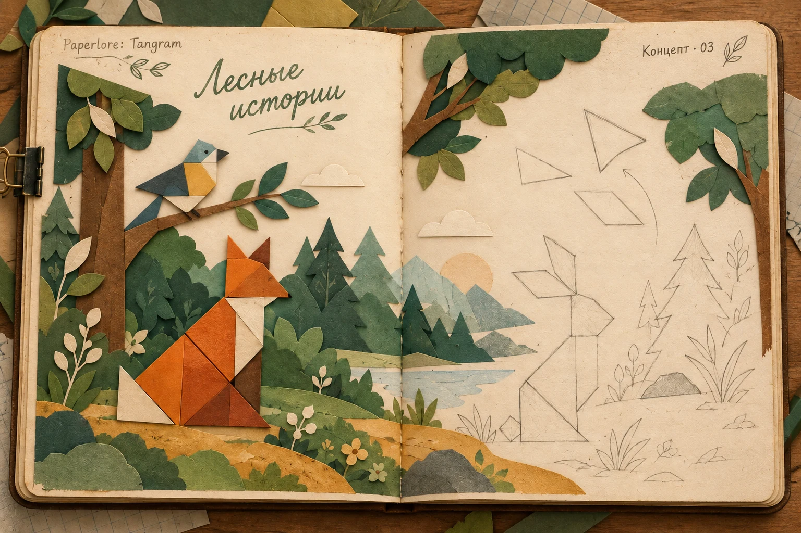
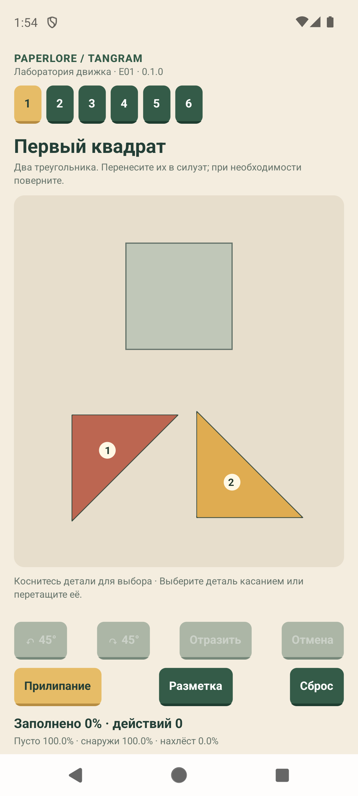

# Paperlore: Tangram

### Бумажные фигуры. Книга, которую хочется оживить.

**AI-концепт будущего оформления, не скриншот игры и не проверенная раскладка уровня.**

[4iuaCraft Studios](https://4iuacraft.com) · [Связаться](mailto:support@4iuacraft.com) · [Профиль автора](https://github.com/sergfila)

После [Paperlore: Jigsaw](https://github.com/sergfila/paperlore-showroom) мы начали самостоятельную головоломку. Вместо фрагментов готовой картины здесь нужно складывать силуэты из геометрических деталей. Хотим попробовать разные формы и количество фигур, сохранив удовольствие от работы с бумагой.

Этот шоурум рассказывает о замысле, экспериментах и проверенных результатах. Исходный код игры закрыт.

## Где мы сейчас

**Актуально на 13 октября 2026: техническая лаборатория Tangram Lab 0.1.0 для Android.** Есть перенос, поворот, отражение, отмена, сброс и диагностика покрытия. В лаборатории шесть сцен: три базовые и три экспериментальные с 1, 4 и 10 деталями. Добавили номера, чтобы легче разбирать щели и похожие формы.

Базовый срез прошёл интерактивные проверки на Pixel 7 и эмуляторе. Новые наборы и анимация проверены на эмуляторе; свежая сборка установлена на Pixel 7, пользовательская проверка продолжается. Установка не означает, что все новые сцены прошли проверку на устройстве. В лаборатории уже подключено автосохранение; восстановление после закрытия проверено на эмуляторе, проверка этой сборки на телефоне ещё впереди. Готовой игры, миров и звёзд пока нет. Дата выпуска не объявлена.

## 1. Сначала — фигура, которую можно собрать

Классические семь деталей служат отправной точкой. Проверяем, удобно ли переносить фигуры, поворачивать их на 45° и отражать, а затем отменять действия. Победа должна зависеть от покрытия силуэта: щели, выход за контур и перекрытия нужно различать, даже когда сборка выглядит почти правильной.

В первом срезе нашли численные ошибки около совпадающих вершин и краткий возврат детали после отпускания. Исправления проверили на Android. Это важнее готового оформления: игрок должен доверять тому, что видит и делает.

## 2. Бумага, которая поворачивается и переворачивается

Проверяем видимый поворот и переворот через ребро. Геометрия решения и промежуточные кадры анимации решают разные задачи: красивое движение не должно временно менять условие победы. Анимация проверена на эмуляторе; полное подтверждение новых сценариев на физическом устройстве остаётся открытым.

## 3. Разные наборы вместо ограничения семью деталями

11 октября добавили разносторонний треугольник, набор из четырёх фигур с асимметричным семиугольником и десять трапеций. Отражение треугольника нельзя заменить обычным поворотом. Все новые детали выпуклые; вогнутые формы и отверстия пока не поддерживаются.

*Реальный скриншот технической лаборатории на эмуляторе. Это инструмент проверки, не финальный интерфейс.*

Автоматические проверки ядра, TypeScript и границ архитектуры проходят; на этом этапе — 28 тестов. Три новые сцены собраны на эмуляторе, проверены отмена и сброс. При тестировании исправили прилипание: точное совмещение должно работать и тогда, когда оно не увеличивает уже достигнутую площадь покрытия.

На телефоне почти собранная сцена показала по 0,5% пустоты и перекрытия. Похожие трапеции имеют небольшие различия размеров; это гипотеза причины, а не окончательный вывод по одному скриншоту. Номера помогут обсуждать конкретные детали. Проверка читаемости таких различий продолжается.

## 4. Вернуться к сборке после закрытия

Автосохранение подключено 11 октября; результат добавлен в шоурум 13 октября. После принудительного закрытия лаборатория восстанавливает позиции деталей, поворот, отражение и историю отмены. Сборки разных сцен сохраняются независимо; сброс также переживает перезапуск.

На эмуляторе проверены перенос, поворот, отражение, закрытие процесса, восстановление и отмена после повторного запуска. На этом срезе проходят 38 автоматических тестов, проверки типов и архитектуры. Проверка автосохранения на физическом телефоне ещё не выполнена; воспроизведение команд и измерение производительности остаются открытыми. Этап сохранения и воспроизводимости в целом не закрыт.

## 5. От лаборатории — к оживающей книге

Выбрали визуальное направление: карандашные наброски на развороте постепенно становятся цветными бумажными аппликациями. Переворот страницы продолжает путешествие. В первую очередь думаем о детях и семейной игре, сохраняя интересные задачи для взрослых.

Это направление будущего продукта. Главный герой, история, число задач на странице и баланс ещё не утверждены. Концепт в начале страницы передаёт настроение; геометрию каждой игровой сборки нужно будет построить и проверить отдельно.

## Что хотим проверить дальше

- Две цели одним набором и перестроение собранного объекта в следующий.
- Двусторонняя бумага: отражение меняет не только форму, но и цвет или узор стороны.
- Просветы, в которых пустота становится частью правильного решения.
- Позже — шарниры, сгибы и порядок бумажных слоёв.

Это кандидаты для отдельных экспериментов. Интересная идея попадёт в игру только после проверки управления, геометрии и совместимости с другими правилами.

[Хронология разработки](docs/development.md) · [Следующие этапы](docs/roadmap.md) · [Как читать материалы](docs/about.md)

[История замысла на сайте](https://4iuacraft.com/ru/journal/paperlore-tangram-a-new-paper-story) · [Новости студии](https://4iuacraft.com/ru/journal) · [support@4iuacraft.com](mailto:support@4iuacraft.com)
